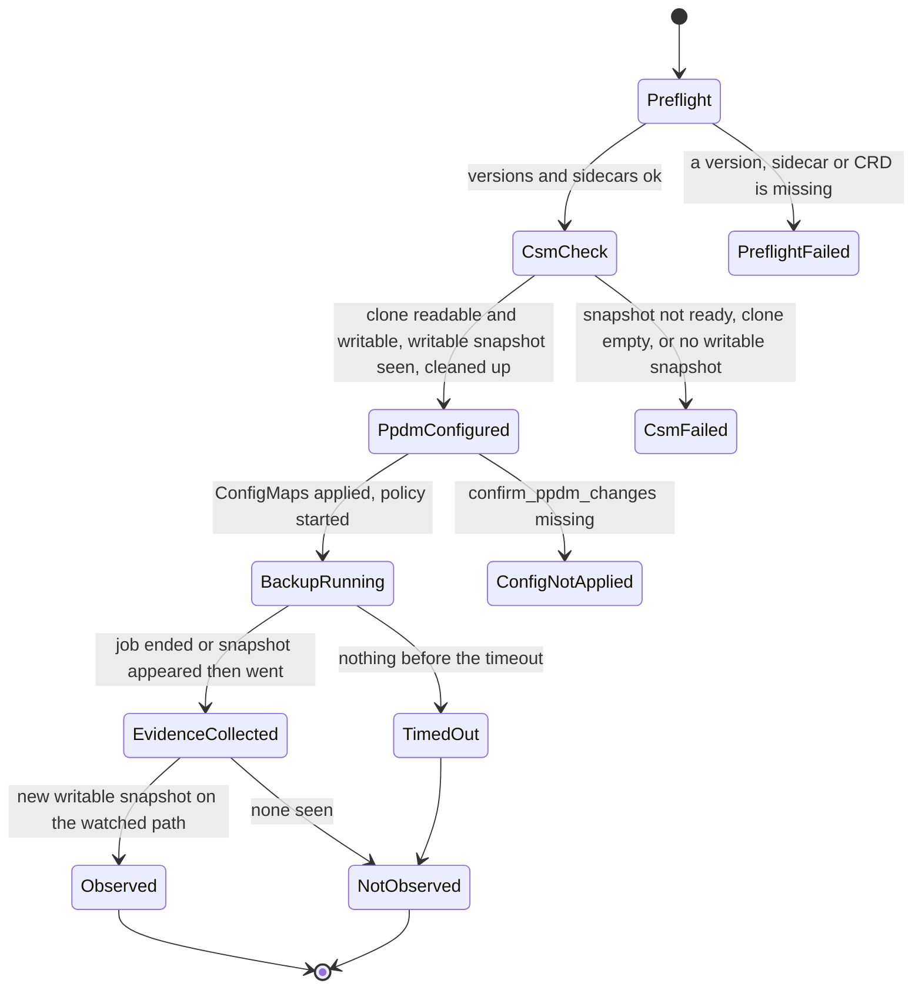
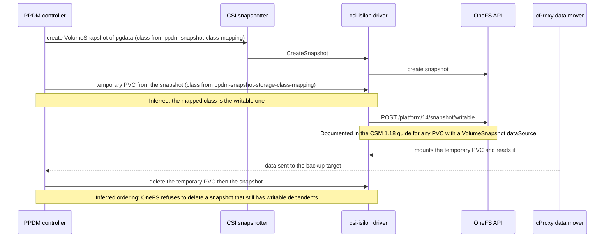
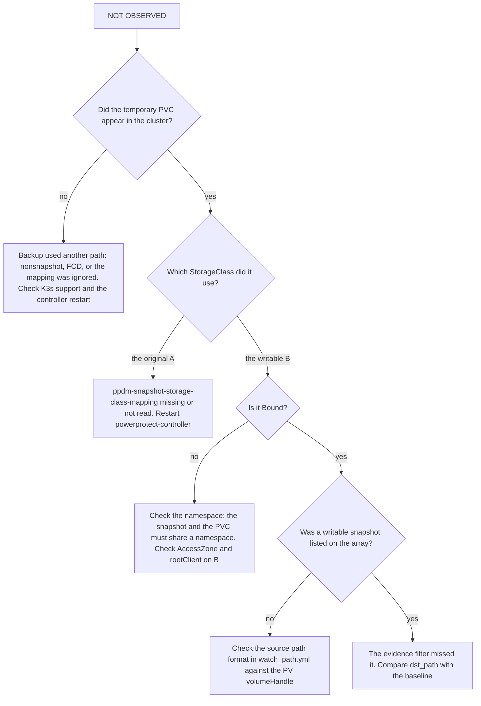

# Writable snapshots behind PPDM backups: demo walkthrough

Dell states that PowerProtect Data Manager (PPDM) can back up important PVs through PowerScale writable snapshots. No document
we hold says it in those words, so this is an **experiment**: it either observes a OneFS writable snapshot during a PPDM backup,
or records that it did not happen. Design: `docs/superpowers/specs/2026-11-15-writable-snapshot-ppdm-design.md`.

Nothing here has run against real clusters, arrays or PPDM yet. Dry-run it before any customer demo.

## What must be true

- OneFS 9.13 or later with SnapshotIQ, Kubernetes 1.34 or later, csi-isilon 2.18.0 or later (CSM 1.18) with the snapshotter and
  resizer sidecars, an external snapshot controller v8.4.0 or later. `--tags preflight` checks all of it, and snapshots the protected PVC once (then deletes the snapshot) to see whether CSI snapshots work on its class (`-e demo_wsnap_probe_snapshot=false` to skip).
- PPDM 20.3 with the cluster registered as an asset source and a protection policy that covers the Wiki.js namespace.
  K3s is not named in the PPDM 20.3 guide: on K3s the PPDM part is an experiment. OpenShift is documented (through OADP).
- The Wiki.js demo is deployed (`pgdata` is the protected PV).

## The run as states

Each state has the command that tells you where you are. A failed step stops the run in its failure state.



- Preflight: `ansible-playbook writable_snapshot_demo.yml --tags preflight`. Failure messages name what is missing.
- CsmCheck: `--tags csm`. The objects live in the namespace of the protected PVC: `kubectl -n app-a get volumesnapshot,pvc,pod` shows the state.
- PpdmConfigured: `kubectl -n powerprotect get configmap` lists `ppdm-snapshot-class-mapping`, `ppdm-snapshot-storage-class-mapping`
  and `ppdm-custom-namespace-storage-class-mapping`.
- BackupRunning / EvidenceCollected: `--tags ppdm,evidence`; the verdict and the timeline path are printed at the end.

## What the audience should see, step by step

1. **Proof that the clone is a real writable snapshot of the snapshot** (`--tags csm`).
   - The protected PV (`pgdata`, replicated by CSM) is snapshotted; a PVC on the writable class is created from the snapshot, in the same namespace.
   - A pod lists the clone (it holds the Postgres files) and writes a file into it; the source is never written. OneFS lists a new writable snapshot whose source path is the volume directory
     (`isi snapshot writable list`, or `GET /platform/14/snapshot/writable`).
   - Say: the clone is instant and copy-on-write, and it never changed the source.
2. **Tell PPDM which StorageClass to use for its temporary PVC** (`--tags ppdm`).
   - The three ConfigMaps map the protected class A to our VolumeSnapshotClass, to the writable class B, and to the data-mover namespace.
   - Say: this mapping is the only place where PPDM's temporary PVC can land on a writable-snapshot class.
3. **Run the PPDM backup of the Wiki.js namespace** (UI, or `-e demo_wsnap_ppdm_automate=true` with an existing policy).
   - `kubectl get volumesnapshot,pvc -A -w` shows the snapshot and the temporary PVC appear and disappear.
   - On the array, a writable snapshot with the same source path appears, then goes.
4. **Read the verdict** (`--tags evidence`). `OBSERVED` or `NOT OBSERVED`, and `timeline.mmd` with what really happened.

## How the chain is expected to work

Steps marked as inferred are not written in any Dell document we hold.



## If the result is NOT OBSERVED



Risks to keep in mind, from the design:

1. The temporary PVC may be created in a namespace other than the snapshot's; the CSM writable path forbids that.
2. PPDM waits only 60 s for the temporary volume to go; a slow CSI delete ends the job with a warning
   `PV <name> of snapshot <name> might not be deleted. Context deadline exceeded.`
3. The backup path may be FCD, non-snapshot, or ROX, so the mapping does not apply.
4. K3s or Kubernetes 1.34 may not be supported by PPDM 20.3 (E-Lab Navigator is not public here).
5. The temporary PVC on B may need NFS root access (`RootClientEnabled`) or an access mode B supports.
6. Restarting `powerprotect-controller` affects every workload PPDM protects on that cluster: do it on a lab only.
7. **CSI snapshots may not be available for replicated volumes.** The v6 guide notes "CSI snapshots available (not for replicated volumes)".
   `pgdata` sits on the replicated class, so PPDM may be unable to snapshot it at all (the preflight probe tells you: it warns when the snapshot never gets ready). If the VolumeSnapshot of `pgdata` never becomes ready,
   protect a PVC on a plain class instead: `-e demo_wsnap_protected_ns=<ns> -e demo_wsnap_protected_pvc=<pvc>
   -e demo_wsnap_source_sc=<its StorageClass>` (B then copies that class's zone and path). Ask Dell which PVs they mean by "important PVs".

## Commands

```bash
# 1. checks and the CSM layer (no PPDM needed)
ansible-playbook -i inventory/openshift writable_snapshot_demo.yml --tags preflight,csm

# 2. PPDM ConfigMaps (restarts powerprotect-controller)
ansible-playbook -i inventory/openshift writable_snapshot_demo.yml --tags ppdm -e confirm_ppdm_changes=yes

# 3. watch while you start the backup in the PPDM UI
ansible-playbook -i inventory/openshift writable_snapshot_demo.yml --tags evidence

# 2 bis. Once per lab: register the cluster in PPDM and create the policy through the REST API.
#        Needs the PPDM RBAC archive (PPDM UI > Downloads > Kubernetes > RBAC) extracted in demo_wsnap_ppdm_rbac_dir and a Data Domain declared in PPDM.
PPDM_PASSWORD=... ansible-playbook -i inventory/openshift writable_snapshot_demo.yml --tags register \
  -e demo_wsnap_ppdm_automate=true -e confirm_ppdm_changes=yes

# 3 bis. REST mode: the policy exists (step 2 bis or the UI); the password comes from the environment.
#        ppdm and evidence must run in the SAME run (the token, the activity id and the baseline are not kept between runs).
PPDM_PASSWORD=... ansible-playbook -i inventory/openshift writable_snapshot_demo.yml --tags ppdm,evidence \
  -e demo_wsnap_ppdm_automate=true -e confirm_ppdm_changes=yes

# 4. cleanup (StorageClasses kept unless -e demo_wsnap_remove_sc=yes)
ansible-playbook -i inventory/openshift writable_snapshot_demo.yml --tags cleanup -e confirm_writable_cleanup=yes
```

Run it on both inventories (`inventory/k3s`, `inventory/openshift`). Rendered manifests and `timeline.mmd` are under `~/dr/writable/`.
The lab values (PPDM host, policy name, Data Domain name, Kubernetes API FQDN, RBAC directory) are placeholders in
`inventory/<track>/group_vars/all/platform.yml`: replace them for each lab. The registration bodies follow the PPDM 20.3 OpenAPI and bottkars; they have not run against a PPDM yet.
